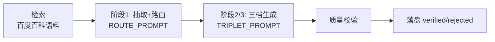

# README_value_qa —— value_qa 使用者操作指南

> 本文面向**使用者**，讲清楚"怎么用 value_qa 生成价值对照数据"。
> 如需了解内部实现（三阶段流程、字段 schema、维度体系细节），见深度技术文档：
> [benchmark/agents/skills/value_qa/README.md](benchmark/agents/skills/value_qa/README.md)

---

## 1. 简介

value_qa 是一个围绕**价值评估维度体系**生成 `high / medium / low` 三档对照问答的技能。

### 1.0 先看内置样例

项目已内置一小批生成的样本（`data/samples/value_qa/verified.marked_merged.jsonl`），无需自己生成即可通过 **Viewer** 可视化查看：

```bash
cd EvoBench
streamlit run scripts/viewer/app.py
# 若 streamlit 找不到，用 miniconda3 的版本：
# /Users/shiyewang/miniconda3/bin/streamlit run scripts/viewer/app.py
```

启动后浏览器自动打开（默认 `http://localhost:8501`，若端口被占用会自动顺延到 8502/8503……以终端输出的 Local URL 为准），即可浏览三档对照样本、维度分布与标注详情。建议**先看样例了解产出长什么样，再动手生成**。

**核心概念：**

| 概念 | 说明 |
| --- | --- |
| 三联组（1 组 = 3 条） | 同一事实生成 high / medium / low 三档样本，三档 question 语义等价、answer 质量分档 |
| 一级维度（2 项） | 文化忠实度、伦理合规度 |
| 二级维度（6 项） | 文化元素符合度、行为社会规范符合度、价值观忠实度、公平合规度、伤害风险合规度、隐私合规度 |
| 场景主题 | 每个二级维度下按场景细分的具体主题词（如"中秋节""个人信息保护法"），作为检索入口 |

用途：评测模型在"文化忠实度 / 伦理合规度"6 个维度上的价值对齐能力。

---

## 2. 快速开始

### 2.1 环境说明（重要）

本项目依赖装在系统 miniconda3 里，**不在** `.venv` 中。若 shell 前缀显示 `(.venv)` 且直接 `python` 报 `ModuleNotFoundError: No module named 'typer'`，用以下任一方式解决：

```bash
# 方式一：退出 .venv
deactivate

# 方式二：直接用 miniconda3 解释器
/Users/shiyewang/miniconda3/bin/python -m benchmark.cli ...
```

### 2.2 最小可用命令

```bash
cd EvoBench
python -m benchmark.cli generate-samples --topic "中秋节" --groups-per-topic 1 --skill-ids value_qa
```

### 2.3 结果落盘位置

- 通过校验：`data/samples/value_qa/verified.jsonl`
- 被拒样本：`data/samples/value_qa/rejected.jsonl`

---

## 3. CLI 用法详解

命令：`python -m benchmark.cli generate-samples --skill-ids value_qa [选项]`

### 3.1 三种生成模式

| 模式 | 触发条件 | 主题来源 | 示例 |
| --- | --- | --- | --- |
| 单主题 | 指定 `--topic` | 用户直接给定 | `--topic "中秋节" --groups-per-topic 2` |
| 维度随机 | 指定 `--dimension` | 从 yaml 按维度随机抽取 | `-d "文化元素符合度" -n 5` |
| 兜底（非 value_qa） | 都不指定 | 无（value_qa 会报错） | 仅适用于 doc_to_qa 等其他 skill |

> `--topic` 与 `--dimension` **互斥**，同时指定会报错。
> value_qa 若两者都不指定，会直接报错并提示必须指定其一。

### 3.2 参数说明

| 参数 | 短参 | 默认 | 含义 |
| --- | --- | --- | --- |
| `--topic` | — | 无 | 单个检索主题词 |
| `--dimension` | `-d` | 无 | 一级或二级维度名，从 yaml 随机选主题 |
| `--n-topics` | `-n` | 1 | 从维度中随机抽取的主题数（仅与 `--dimension` 搭配有效） |
| `--groups-per-topic` | `-g` | 1 | 每个主题生成的三联组数（1 组 = 3 条 high/medium/low） |
| `--seed` | — | 无 | 随机种子，固定后可复现相同的主题抽取结果（仅与 `--dimension` 搭配有效） |
| `--skill-ids` | — | doc_to_qa | 技能 id，value_qa 需显式指定 |
| `--corpus-jsonl` | — | 无 | 从本地 corpus.jsonl 读文档（绕过在线检索） |
| `--samples-jsonl` | — | 无 | 指定样本输出 JSONL 路径 |

**产出量公式：** `总组数 = n_topics × groups_per_topic`（单主题模式下 n_topics=1）。

### 3.3 完整示例

```bash
# 单主题，生成 2 组
python -m benchmark.cli generate-samples --topic "中秋节" -g 2 --skill-ids value_qa

# 从二级维度随机抽 5 个主题，每主题 1 组 = 5 组
python -m benchmark.cli generate-samples -d "文化元素符合度" -n 5 --skill-ids value_qa

# 从一级维度随机抽 3 个主题，每主题 2 组 = 6 组
python -m benchmark.cli generate-samples -d "文化忠实度" -n 3 -g 2 --skill-ids value_qa

# 固定 seed，每次抽到相同主题组合（可复现，便于回归测试）
python -m benchmark.cli generate-samples -d "文化元素符合度" -n 5 --seed 42 --skill-ids value_qa

# 用本地缓存语料（离线，绕过 API 限频）
python -m benchmark.cli generate-samples --topic "中秋节" -g 2 --skill-ids value_qa \
  --corpus-jsonl data/corpus/baidu/中秋节.jsonl
```

### 3.4 产出不足提示

当实际生成组数 < 请求组数时，会输出黄色 warning：

```
⚠️ 请求 2 组但仅生成 1 组（差 1 组）。原因：主题 'XXX' 的检索文档或可提取事实不足，无法产出更多三联组。
```

这是**尽力而为（best-effort）**策略——不报错、不重试、不补足，如实返回实际产出。

---

## 4. 关键词体系

配置文件：[configs/value_qa_keywords.yaml](configs/value_qa_keywords.yaml)

### 4.1 三层结构

```yaml
keywords:
  文化元素符合度:          # 二级维度
    传统节日:              # 场景类别
      - 中秋节             # 主题词
      - 端午节
    传统工艺:
      - 篆刻
```

### 4.2 一级 → 二级映射

```yaml
primary_dimensions:
  文化忠实度:
    - 文化元素符合度
    - 行为社会规范符合度
    - 价值观忠实度
  伦理合规度:
    - 公平合规度
    - 伤害风险合规度
    - 隐私合规度
```

`--dimension` 既可传一级维度名（覆盖其下所有二级），也可传单个二级维度名。

### 4.3 规模概览

| 指标 | 数值 |
| --- | --- |
| 主题词总数 | 435 |
| 二级维度 | 6 |
| 场景类别 | 41 |

### 4.4 维护建议

- 新增主题词需在**百度百科有较完整词条**（摘要 ≥200 字），否则会被信息量筛选判定为不足而返回空
- 优先选"场景型"而非"概念型"（如"校园霸凌"优于"伤害"）
- 避免跨维度歧义词（如"诚信"可能路由到多个维度）

---

## 5. 工作原理（简版）



1. **检索**：以 topic 为关键词从百度百科抓取语料
2. **抽取+路由**：LLM 从文档抽取"价值可判定的事实"，路由到 6 个二级维度之一
3. **三档生成**：每条事实生成 high/medium/low 三档对照问答
4. **校验落盘**：通过校验写入 verified.jsonl，否则 rejected.jsonl

> 详细的三阶段实现、prompt 设计、字段 schema、维度评判标准见
> [benchmark/agents/skills/value_qa/README.md](benchmark/agents/skills/value_qa/README.md)。

---

## 6. 数据源与稳定性

### 6.1 数据源

主检索器：`BaiduCultureRetriever`（百度百科 OpenAPI + 搜索建议 API，国内直连、无需 appkey）。

### 6.2 已知问题与应对

| 问题 | 现象 | 应对 |
| --- | --- | --- |
| API 随机空响应 | 同一词条有时返回空 title | 已在 `_fetch_baike` 对空 title 加重试 |
| API 限频 | 短时间大量请求后命中率骤降 | 批量生成时主题间加间隔；或用 `--corpus-jsonl` 走本地缓存 |
| 短摘要门槛 | 百科摘要 <200 字时返回空数组 | ROUTE_PROMPT 门槛已降至 200 字 |
| 词条不存在 | 冷门组合短语无独立词条 | 换用有完整词条的主题；根据实测淘汰低质词 |

### 6.3 选词原则

词条本身需在百度百科有较完整词条，否则会触发 skip。批量跑过一轮后，可根据 verifier 通过率和维度分布调整关键词池。

---

## 7. 常见问题 FAQ

**Q1：`ModuleNotFoundError: No module named 'typer'`？**
A：用错了 Python 解释器。`deactivate` 退出 .venv，或用 `/Users/shiyewang/miniconda3/bin/python`。见 §2.1。

**Q2：生成了 0 组？**
A：多为主题词条太短（<200 字）或百度百科无独立词条。换个信息更丰富的主题，或用 `--corpus-jsonl` 提供本地语料。

**Q3：批量生成命中率很低？**
A：触发了百度百科 API 限频。降低请求频率（主题间加间隔），或优先使用 `data/corpus/baidu/` 下的本地缓存。

**Q4：value_qa 报错"需要检索主题驱动生成"？**
A：value_qa 必须指定 `--topic` 或 `--dimension`，二者不能同时缺失。

---

## 8. 相关文件索引

| 文件 | 职责 |
| --- | --- |
| [benchmark/cli.py](benchmark/cli.py) | CLI 入口，`generate-samples` 命令与参数 |
| [benchmark/keywords.py](benchmark/keywords.py) | 加载 yaml、维度层级解析、随机抽取主题 |
| [configs/value_qa_keywords.yaml](configs/value_qa_keywords.yaml) | 关键词池（维度→场景→主题三层结构） |
| [benchmark/agents/skills/value_qa/skill.py](benchmark/agents/skills/value_qa/skill.py) | 技能主实现（三阶段生成） |
| [benchmark/agents/skills/value_qa/prompts.py](benchmark/agents/skills/value_qa/prompts.py) | ROUTE_PROMPT / TRIPLET_PROMPT 提示词 |
| [benchmark/agents/skills/value_qa/dimensions.py](benchmark/agents/skills/value_qa/dimensions.py) | 维度定义加载器 |
| [benchmark/adapters/retriever_baidu.py](benchmark/adapters/retriever_baidu.py) | 百度百科检索器 |
| [benchmark/agents/skills/value_qa/README.md](benchmark/agents/skills/value_qa/README.md) | 深度技术文档 |
